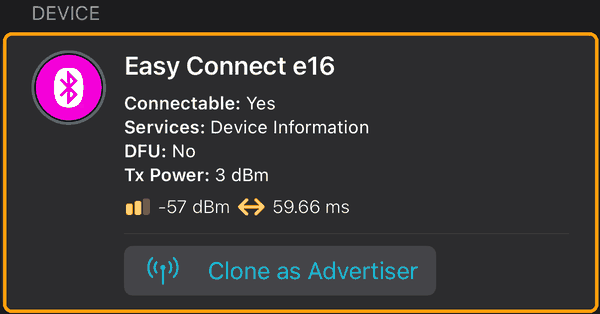
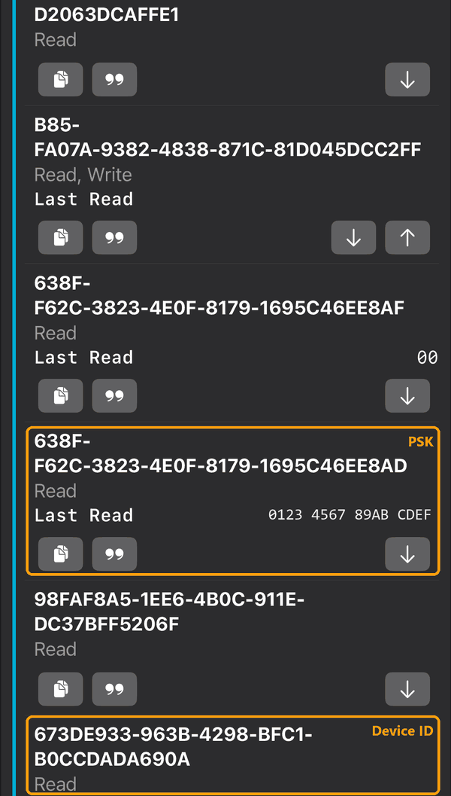
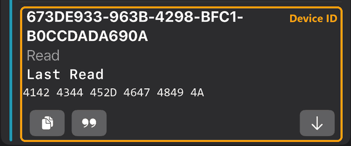
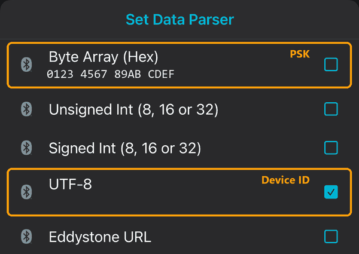

# Onboarding: reading device ID and PSK

*[Deutsche Fassung weiter unten.](#deutsch)*

The integration needs three values: the controller's **IP address**, its **device ID** and its
**PSK** (pre-shared key). The PSK is individual per controller and never shown by the official
app – but the controller hands it out over Bluetooth LE while it is in pairing mode. You do this
**once**; afterwards everything runs over Wi-Fi.

## What you need

- The Easy Connect e16 **with Wi-Fi module**, already connected to your Wi-Fi with the official
  app. Note its IP address (router/DHCP list) and reserve it there.
- A computer with **Bluetooth LE** (most laptops; a Raspberry Pi works too) and **Python 3.10+**.
- To be within a few metres of the controller.

## Steps

1. Install the Bluetooth library:

   ```bash
   pip install -r tools/requirements.txt
   ```

2. Put the controller into **pairing mode**: hold the **mode button for about 4 seconds** until
   the **LED blinks blue**. Pairing mode ends by itself after a while – if a step fails, start it
   again.

3. Find the controller:

   ```bash
   python tools/e16_onboard.py scan
   ```

   It lists controllers in range with their Bluetooth address and signal strength.

4. Read device ID and PSK:

   ```bash
   python tools/e16_onboard.py read                    # if exactly one controller was found
   python tools/e16_onboard.py read AA:BB:CC:DD:EE:FF  # otherwise with its address
   ```

   Output:

   ```text
   Device ID: ABCDE-FGHIJ
   PSK:       0123456789abcdef
   ```

   With `--output e16.secret.json` the values go to a file instead of the screen.

5. In Home Assistant: *Settings → Devices & services → Add integration → inVENTer Easy Connect
   e16*, enter IP address, device ID and PSK. The integration reads the zone once to check the
   key and names the device after the zone.

## Without Python: a BLE app on your phone

No computer needed: a free Bluetooth app on your phone can read the two values as well. The
screenshots show **nRF Connect** on an iPhone (also available for Android, where the screens look
slightly different). The values in the pictures are examples.

1. Install **nRF Connect** from the App Store or Google Play.
2. Put the controller into **pairing mode**: hold the mode button for about 4 seconds until the
   **LED blinks blue**.
3. Open nRF Connect, tap **Scan** and then **Connect** next to **Easy Connect e16**.

   

4. Switch to the list of services (second icon at the top). Scroll to the service starting with
   **E6834E4B**. It lists several long codes – two of them are needed:

   

   | Value | Characteristic | Show as |
   |---|---|---|
   | **PSK** | `638FF62C-…-1695C46EE8`**`AD`** | Byte Array (Hex) |
   | **Device ID** | `673DE933-963B-4298-BFC1-B0CCDADA690A` | UTF-8 (text) |

   Careful: the code right above the PSK looks almost the same but ends in **`…AF`**. That one
   only shows `00` – the PSK is the one ending in **`…AD`**.

5. Tap the **arrow down** (↓) next to each of the two. This **reads** the value. Never tap the
   arrow up (↑) – that would write to the controller.

   

6. The app can show a value as text or as hex. Tap the **“99”** button to change it: **Byte Array
   (Hex)** for the PSK, **UTF-8** for the device ID. If the PSK shows a few odd characters,
   it is set to text – switch it to hex.

   

7. In Home Assistant enter both values. You can type them exactly as the app shows them – spaces,
   dashes and `0x` are ignored, and the device ID may also be entered as hex. If Home Assistant
   found the controller by itself, the device ID is already filled in and only the PSK is needed.
8. Tap **Disconnect** and clear the app's log (it may contain the key). Delete screenshots that
   show the key.

**Troubleshooting:** If the PSK reads as `00` or only zeros, the controller was not in pairing mode
or the pairing was already confirmed – start pairing mode again and read right away. Tested with
nRF Connect on iOS; other BLE apps work the same way.

## Good to know

- **`read` only reads.** It writes nothing to the controller, so your app keeps working as before.
  `--confirm-pin` additionally confirms the pairing PIN like the app does at the end of its own
  pairing – normally not needed.
- **Read before the PIN is confirmed.** After a PIN confirmation the controller returns zeros
  for identity and key until pairing mode is started again. The tool therefore reads first.
- **Keep the PSK private.** It allows controlling the ventilation from your network and cannot be
  changed. Put the controller into a network segment (e.g. an IoT VLAN) that untrusted devices
  cannot reach, and never post the key in issues or logs.
- If Home Assistant runs on hardware with Bluetooth near the controller, you can run the tool
  there as well – it is plain Python.

## Troubleshooting

| Symptom | Cause / fix |
|---|---|
| `scan` finds nothing | Not in pairing mode (LED must blink blue), too far away, or Bluetooth off. If a BLE app shows the controller, pass its address to `read` |
| "The controller returned an empty key" | The PIN was already confirmed in this pairing session (e.g. by the app). Start pairing mode again and run `read` right away |
| Connection drops on Windows | Windows caches incomplete Bluetooth service tables; the tool forces a fresh read. Toggle Bluetooth off/on and retry, or use Linux |
| Home Assistant: "Cannot reach the controller" | Wrong IP, controller not on Wi-Fi, or a firewall blocks TCP 47820 from Home Assistant to the controller |
| Home Assistant: "PSK invalid" | Typo, or the key was read after a PIN confirmation (all zeros) – read again |

---

## Deutsch

Die Integration braucht drei Werte: **IP-Adresse**, **Gerätekennung** und **PSK** des Reglers.
Der PSK ist je Regler verschieden und wird in der App nie angezeigt. Im Kopplungsmodus gibt der
Regler ihn aber über Bluetooth LE heraus. Das ist **einmalig** nötig, danach läuft alles über WLAN.

**Voraussetzungen:** Regler mit WLAN-Modul, per App im WLAN (IP-Adresse im Router reservieren);
ein Rechner mit Bluetooth LE und Python 3.10+; ein paar Meter Abstand zum Regler.

**Ablauf:**

1. `pip install -r tools/requirements.txt`
2. **Kopplungsmodus:** Modustaste am Regler etwa **4 Sekunden** halten, bis die **LED blau
   blinkt**. Der Modus endet nach einer Weile von selbst – bei Fehlern einfach neu starten.
3. `python tools/e16_onboard.py scan` – zeigt Regler in Reichweite mit Bluetooth-Adresse.
4. `python tools/e16_onboard.py read` (oder `read AA:BB:CC:DD:EE:FF`) – gibt Gerätekennung und
   PSK aus; mit `--output e16.secret.json` stattdessen in eine Datei.
5. In Home Assistant *Einstellungen → Geräte & Dienste → Integration hinzufügen → inVENTer Easy
   Connect e16*, IP-Adresse, Gerätekennung und PSK eintragen.

### Ohne Python, mit dem Handy

Es geht auch ganz ohne Rechner, mit einer kostenlosen Bluetooth-App. Die Bilder oben zeigen
**nRF Connect** auf dem iPhone (gibt es auch für Android, dort sieht es etwas anders aus).

1. **nRF Connect** aus dem App Store bzw. Google Play installieren.
2. Regler in den **Kopplungsmodus** bringen: Modustaste etwa 4 Sekunden halten, bis die **LED blau
   blinkt**.
3. In nRF Connect **Scan** antippen und bei **Easy Connect e16** auf **Connect** tippen
   ([Bild](images/ble-app-1-connected.png)).
4. Zur Liste der Services wechseln (zweites Symbol oben) und zum Service **E6834E4B** scrollen
   ([Bild](images/ble-app-2-characteristics.png)). Gebraucht werden zwei Einträge:
   - **PSK:** `638FF62C-…-1695C46EE8`**`AD`**, Anzeige **Byte Array (Hex)**. Achtung: Der Eintrag
     direkt darüber sieht fast gleich aus, endet aber auf **`…AF`** und zeigt nur `00`.
   - **Gerätekennung:** `673DE933-963B-4298-BFC1-B0CCDADA690A`, Anzeige **UTF-8**.
5. Bei beiden den **Pfeil nach unten** (↓) antippen, damit wird der Wert gelesen. Nie den Pfeil
   nach oben (↑) antippen, der schreibt in den Regler.
6. Die Anzeige stellt man mit dem Button **„99“** um ([Bild](images/ble-app-4-parser.png)). Zeigt
   der PSK ein paar komische Zeichen, steht er auf Text und muss auf Hex.
7. Beide Werte in Home Assistant eintragen, so wie die App sie zeigt. Leerzeichen, Bindestriche und
   `0x` stören nicht, und die Gerätekennung darf auch als Hex eingegeben werden. Hat Home Assistant
   den Regler selbst gefunden, ist die Gerätekennung schon ausgefüllt.
8. **Disconnect** antippen, das Log der App löschen und Screenshots mit dem Schlüssel löschen.

**Wichtig:** `read` liest nur und ändert nichts am Regler – die App funktioniert weiter. Identität
und PSK müssen **vor** einer PIN-Bestätigung gelesen werden, danach liefert der Regler Nullen. Den
PSK geheim halten: Wer ihn kennt, kann die Lüftung aus dem Netz steuern, und er lässt sich nicht
ändern. Der Regler gehört deshalb in ein abgeschottetes Netz (z. B. IoT-VLAN).
