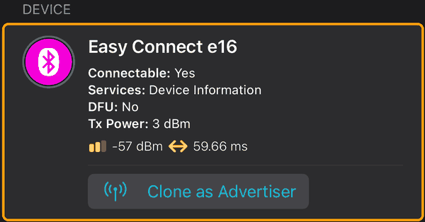
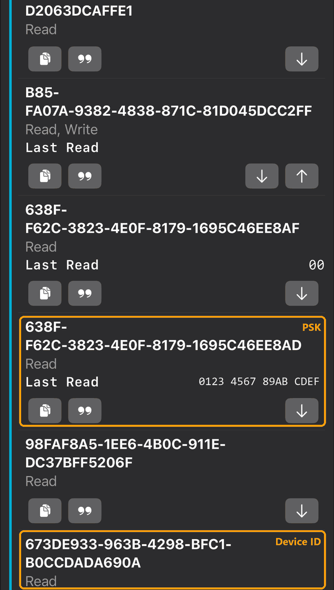
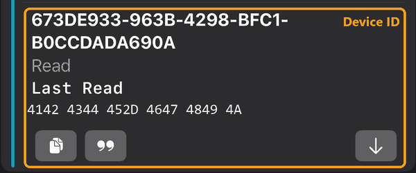
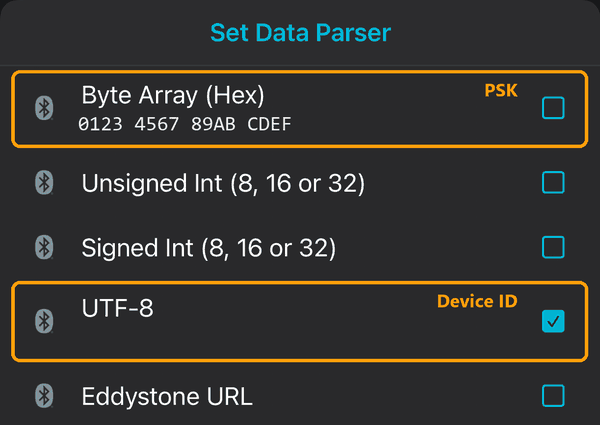

# Reading the device ID and PSK

The integration needs three values: the controller's **IP address**, its **device ID** and its
**PSK** (pre-shared key). The PSK is different for every controller and the official app never
shows it, but the controller hands it out over Bluetooth LE while it is in pairing mode. You do
this **once**; afterwards everything runs over Wi-Fi.

There are two ways to read the values:

- [With a Bluetooth app on your phone](#with-a-bluetooth-app-on-your-phone): no computer needed.
- [With the Python tool](#with-the-python-tool) from this repository, on a computer with
  Bluetooth LE.

Both only read. They change nothing on the controller, and the official app keeps working.

## Before you start

- The Easy Connect e16 needs the **Wi-Fi module** and must already be on your Wi-Fi (set up with
  the official app). Look up its IP address in your router and reserve it there.
- Stay within a few metres of the controller.
- **Pairing mode:** hold the **mode button for about 4 seconds** until the **LED blinks blue**.
  Pairing mode ends by itself after a while, so read the values right away. If a step fails,
  start pairing mode again.

## With a Bluetooth app on your phone

The screenshots show **nRF Connect** on an iPhone. It is free for iOS and Android; on Android the
screens look slightly different. The values in the pictures are examples.

1. Install **nRF Connect** from the App Store or Google Play.
2. Put the controller into pairing mode.
3. Open nRF Connect, tap **Scan**, then **Connect** next to **Easy Connect e16**.

   

4. Switch to the list of services (second icon at the top) and scroll to the service starting
   with **E6834E4B**. Two of its entries are needed:

   

   | Value | Characteristic | Show as |
   |---|---|---|
   | **PSK** | `638FF62C-…-1695C46EE8`**`AD`** | Byte Array (Hex) |
   | **Device ID** | `673DE933-963B-4298-BFC1-B0CCDADA690A` | UTF-8 (text) |

   The entry right above the PSK looks almost the same but ends in **`…AF`** and only shows `00`.
   The PSK is the one ending in **`…AD`**.

5. Tap the **arrow down** (↓) next to each of the two entries to read it. Never tap the arrow up
   (↑): that writes to the controller.

   

6. Tap the **"99"** button to choose how a value is shown: **Byte Array (Hex)** for the PSK,
   **UTF-8** for the device ID. If the PSK shows a few odd characters, it is set to text; switch
   it to hex.

   

7. Enter both values in Home Assistant exactly as the app shows them. Spaces, dashes and `0x` are
   ignored, and the device ID may also be entered as hex.
8. Tap **Disconnect**, clear the app's log and delete any screenshots: they contain the key.

## With the Python tool

You need a computer with **Bluetooth LE** (most laptops; a Raspberry Pi works too) and
**Python 3.10** or newer.

1. Install the Bluetooth library:

   ```bash
   pip install -r tools/requirements.txt
   ```

2. Put the controller into pairing mode.
3. Find the controller. This lists controllers in range with their Bluetooth address and signal
   strength:

   ```bash
   python tools/e16_onboard.py scan
   ```

4. Read device ID and PSK:

   ```bash
   python tools/e16_onboard.py read                    # if exactly one controller was found
   python tools/e16_onboard.py read AA:BB:CC:DD:EE:FF  # otherwise with its address
   ```

   ```text
   Device ID: ABCDE-FGHIJ
   PSK:       0123456789abcdef
   ```

   With `--output e16.secret.json` the values go to a file instead of the screen.

## Add the controller in Home Assistant

If Home Assistant has discovered the controller, host and device ID are already filled in and you
only enter the PSK. Otherwise go to *Settings → Devices & services → Add integration → inVENTer
Easy Connect e16* and enter IP address, device ID and PSK. The integration reads the zone once to
check the key and names the device after the zone.

## Good to know

- **Read before the PIN is confirmed.** When the app finishes its own pairing, it confirms a PIN.
  After that the controller returns zeros for device ID and key until pairing mode is started
  again. The Python tool therefore reads first; `--confirm-pin` additionally confirms the PIN like
  the app does, which is normally not needed.
- **Keep the PSK private.** It allows controlling the ventilation from your network and cannot be
  changed. Put the controller into a network segment that untrusted devices cannot reach (for
  example an IoT VLAN), and never post the key in issues or logs.
- If Home Assistant runs on hardware with Bluetooth near the controller, you can run the Python
  tool there as well.

## Troubleshooting

| Symptom | Cause and fix |
|---|---|
| The controller doesn't show up (`scan` or app) | Not in pairing mode (the LED must blink blue), too far away, or Bluetooth is off. If a Bluetooth app finds the controller but `scan` doesn't, pass its address to `read` |
| PSK is `00` or only zeros, or "The controller returned an empty key" | The PIN was already confirmed in this pairing session, for example by the app. Start pairing mode again and read right away |
| Connection drops on Windows | Windows caches incomplete Bluetooth service tables; the tool forces a fresh read. Switch Bluetooth off and on and retry, or use Linux |
| Home Assistant: "Cannot reach the controller" | Wrong IP address, controller not on Wi-Fi, or a firewall blocks TCP port 47820 between Home Assistant and the controller |
| Home Assistant: "PSK invalid" | Typo, or the key was read after a PIN confirmation (all zeros). Read it again |
